# Sistem Pemesanan Restoran (RestoApp)

> **Tugas Praktik Demonstrasi Sertifikasi Programmer — BNSP**  
> Dibuat dengan arsitektur terstruktur dan berorientasi objek (OOP), memanfaatkan library pre-existing, serta memenuhi seluruh kriteria unjuk kerja 9 Unit Kompetensi Skema Pemrogram (Programmer) KKNI Level 4.

---

## 1. Ringkasan Proyek

Aplikasi web untuk staf restoran yang mencakup fungsionalitas:
- **Pengelolaan Data Master**: Pelanggan, Meja, dan Menu (CRUD).
- **Pemesanan Meja**: Reservasi meja dengan validasi bertingkat (kapasitas tamu & bentrok jadwal).
- **Rincian Item Pesanan**: Menambahkan hidangan menu ke reservasi dengan kalkulasi subtotal dan grand total otomatis (`COALESCE(SUM(subtotal), 0)`).
- **Manajemen Status Transaksi**: Menunggu &rarr; Dipesan &rarr; Selesai / Dibatalkan.
- **Laporan & Ekspor PDF**: Rekapitulasi transaksi dan omset per rentang tanggal serta cetak dokumen resmi format PDF (Dompdf).
- **Pengujian Unit Otomatis**: Unit testing menggunakan PHPUnit 11 (8 skenario pengujian, 15 assertions lolos 100%).

---

## 2. Diagram Arsitektur & Pemodelan Sistem (J.620100.009.01)

Sistem dimodelkan secara visual mencakup relasi basis data, arsitektur kelas OOP, use case, flowchart, dan activity diagram:

### 2.1 Entity Relationship Diagram (ERD Basis Data)
Ternormalisasi 3NF dengan 5 tabel relasional pada MySQL InnoDB:

<p align="center">
  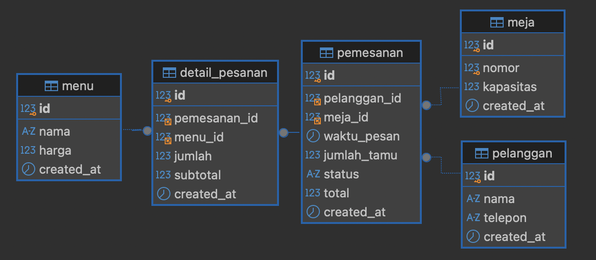
</p>

```
[pelanggan] (1) <─────── (N) [pemesanan] (1) <─────── (N) [detail_pesanan] (N) ───────> (1) [menu]
                                  │
                                  │ (N)
                                  │
                              (1) [meja]
```
- **`pelanggan`**: Menyimpan identitas pelanggan (`id`, `nama`, `telepon`, `email`, `alamat`).
- **`meja`**: Data fisik meja restoran (`id`, `nomor_meja`, `kapasitas`, `status`).
- **`menu`**: Katalog kuliner dan status ketersediaan (`id`, `nama_menu`, `kategori`, `harga`, `status`).
- **`pemesanan`**: Transaksi reservasi (`id`, `pelanggan_id`, `meja_id`, `waktu_pesan`, `jumlah_tamu`, `total`, `status`). Dilengkapi indeks komposit `idx_meja_waktu(meja_id, waktu_pesan)`.
- **`detail_pesanan`**: Relasi item menu pada reservasi (`id`, `pemesanan_id`, `menu_id`, `jumlah`, `harga_satuan`, `subtotal`).

### 2.2 UML Class Diagram (Paradigma OOP)
Penerapan Abstract Class `BaseModel`, Pewarisan (`Pelanggan`, `Meja`, `Menu`), Enkapsulasi `Pemesanan`, dan Singleton `Database`:

<p align="center">
  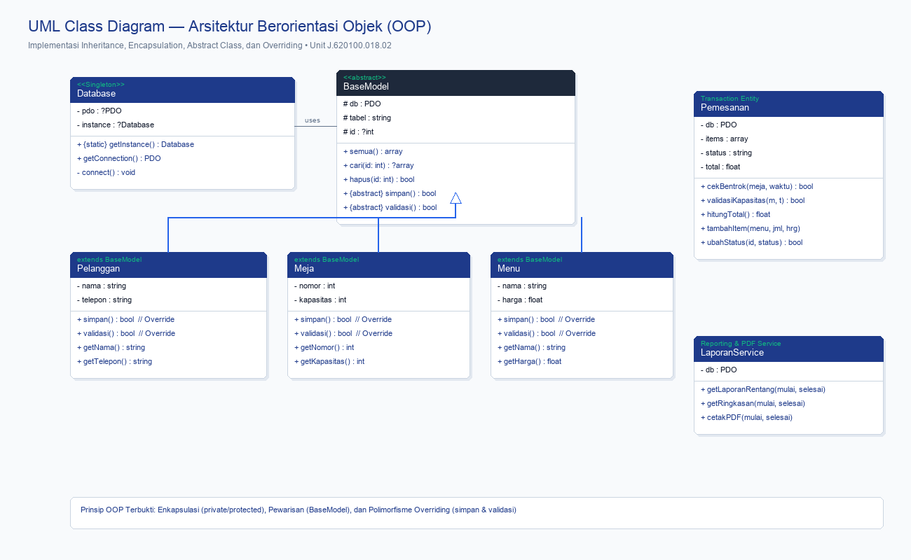
</p>

```
                  ┌──────────────────────┐
                  │ <<abstract>>         │
                  │ BaseModel            │
                  └──────────┬───────────┘
                             │ extends
         ┌───────────────────┼───────────────────┐
         │                   │                   │
┌────────┴────────┐ ┌────────┴────────┐ ┌────────┴────────┐
│ Pelanggan       │ │ Meja            │ │ Menu            │
└─────────────────┘ └─────────────────┘ └─────────────────┘
```

### 2.3 Flowchart Alur Reservasi & Validasi Terstruktur (J.620100.017.02)
Alur transaksi sistem:

<p align="center">
  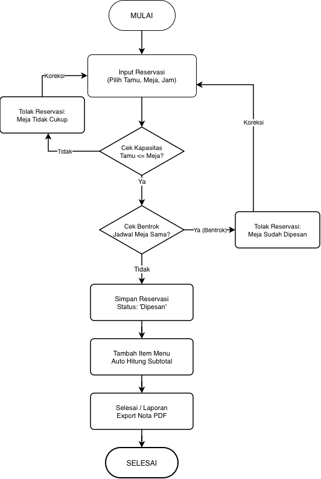
</p>

1. Mulai &rarr; Buka form reservasi meja.
2. Input data pemesanan (Pelanggan, Meja, Tanggal/Waktu, Jumlah Tamu).
3. **Pengecekan Kapasitas Tamu**: Apakah `jumlah_tamu <= kapasitas_meja`?
   - *Tidak*: Tampilkan peringatan kapasitas, kunci tombol simpan, kembali ke input untuk koreksi.
   - *Ya*: Lanjut ke pengecekan jadwal.
4. **Pengecekan Bentrok Jadwal**: Apakah meja sudah memiliki reservasi aktif di jam tersebut (`WHERE status != 'Dibatalkan'`)?
   - *Bentrok*: Tampilkan notifikasi jadwal tidak tersedia, arahkan koreksi waktu/meja.
   - *Tersedia*: Tombol simpan aktif.
5. Simpan data reservasi ke tabel `pemesanan` dengan status `'Dipesan'`.
6. Buka halaman detail pesanan &rarr; Input hidangan menu &rarr; Sistem menghitung subtotal & grand total.
7. Cetak bukti / Laporan PDF &rarr; Selesai.

### 2.4 UML Use Case Diagram (Identifikasi Kebutuhan & Aktor)
Mendefinisikan batasan sistem (*System Boundary*), dengan 1 aktor utama (**Staf Restoran**) yang memiliki akses pada 4 fungsi operasional:

<p align="center">
  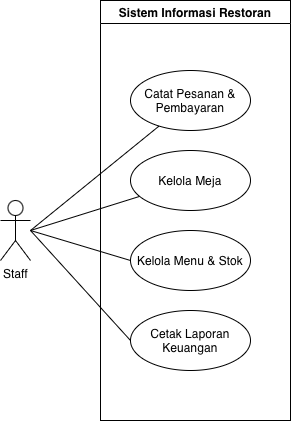
</p>

1. **Catat Pesanan & Pembayaran**: Mencatat reservasi meja pelanggan, input pesanan hidangan, kalkulasi total otomatis, serta pencetakan bukti nota pembayaran.
2. **Kelola Meja**: Melakukan operasi CRUD (Tambah, Ubah, Hapus) nomor meja dan kapasitas kursi tamu.
3. **Kelola Menu & Stok**: Mengelola katalog makanan dan minuman, harga satuan (Rp), serta status ketersediaan stok (Tersedia / Habis).
4. **Cetak Laporan Keuangan**: Menyaring riwayat transaksi per rentang tanggal dan mengekspor dokumen rekapitulasi penjualan resmi ke format PDF.

### 2.5 UML Activity Diagram (Alur Transaksi & Validasi Bertingkat)
Memodelkan aktivitas lintas 3 swimlane (**Staf Restoran**, **Sistem RestoApp**, dan **Basis Data MySQL**):

<p align="center">
  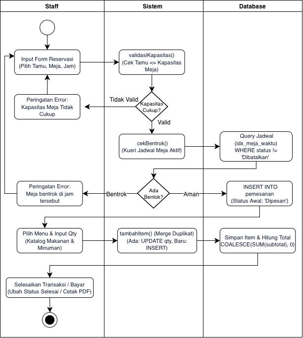
</p>

- **Tahap 1 (Validasi Kapasitas)**: Memeriksa apakah jumlah tamu melebihi kapasitas meja (`validasiKapasitas()`). Jika melebihi, sistem secara reaktif menampilkan alert peringatan, border merah, dan mengunci tombol submit.
- **Tahap 2 (Validasi Jadwal)**: Memeriksa bentrok waktu reservasi pada meja terpilih via kueri `WHERE meja_id = :meja_id AND waktu_pesan = :waktu_pesan AND status != 'Dibatalkan'`. Jika jadwal aman, badge hijau aktif dan tombol reservasi terbuka.
- **Simpan & Rincian Pesanan**: Status awal dicatat `'Dipesan'`. Staf dapat menambahkan item menu dengan kalkulasi subtotal otomatis dan penggabungan kuantitas (*merge quantity*) jika menu yang sama ditambahkan berulang kali.

---

## 3. Struktur Direktori Proyek

```
restoran/
├── berkas_bnsp/                # Berkas deliverable resmi sertifikasi BNSP (docx, pptx)
│   ├── 1_Lampiran_Koding_Sistem_Pemesanan_Restoran.docx
│   ├── 2_Laporan_Pengembangan_Sistem_Pemesanan_Restoran.docx
│   ├── 3_Slide_Presentasi_Demonstrasi_BNSP.pptx
│   └── Lampiran_Tangkapan_Layar_Sistem.docx # Lampiran 13 tangkapan layar & pengujian
├── composer.json               # Konfigurasi dependensi library (Dompdf, PHPUnit)
├── composer.lock               # Lockfile dependensi
├── phpunit.xml                 # Konfigurasi test suite PHPUnit
├── README.md                   # Dokumentasi lengkap & laporan teknis proyek
├── database/
│   └── schema.sql              # DDL basis data MySQL (5 tabel, FK, indeks, & seed data)
├── docs/                       # Dokumen pendukung & panduan asesmen BNSP
│   └── KUNCI_JAWABAN_ASESMEN_BNSP.md # Panduan komprehensif tanya-jawab 9 unit SKKNI
├── logs/
│   └── app.log                 # Catatan aktivitas & penanganan error aplikasi
├── public/                     # Tampilan antarmuka web (UI)
│   ├── assets/css/style.css    # Desain antarmuka modern, responsif & interaktif
│   ├── header.php              # Header & navigasi navbar
│   ├── footer.php              # Footer template
│   ├── index.php               # Dashboard ringkasan & statistik (F-01)
│   ├── pelanggan.php           # CRUD Data Pelanggan (F-02)
│   ├── meja.php                # CRUD Data Meja Restoran (F-03)
│   ├── menu.php                # CRUD Data Menu Makanan/Minuman (F-04)
│   ├── pemesanan.php           # Buat reservasi meja & validasi 2 tahap (F-05, F-06)
│   ├── detail_pesanan.php      # Tambah item menu ke pemesanan & hitung subtotal (F-07)
│   └── laporan.php             # Laporan filter tanggal & export PDF via Dompdf (F-08)
├── screenshots/                # Dokumentasi gambar diagram & tangkapan layar antarmuka
│   ├── diagram_use_case.png
│   ├── diagram_erd.png
│   ├── diagram_flowchart.png
│   ├── diagram_activity.png
│   ├── diagram_class.png
│   ├── 01_dashboard.png
│   ├── 02_kelola_meja.png
│   ├── 03_kelola_menu.png
│   ├── 04_kelola_pelanggan.png
│   ├── 05_daftar_pemesanan.png
│   ├── 06_detail_pesanan.png
│   ├── 07_laporan_transaksi.png
│   ├── 08_modal_validasi_kapasitas.png
│   ├── 09_modal_jadwal_tersedia.png
│   ├── 10_hasil_laporan_pdf.png
│   ├── 11_terminal_phpunit.png
│   ├── 12_terminal_php_lint.png
│   └── 13_database_struktur_tabel.png
├── scripts/                    # Skrip generator dokumen & lampiran Word
├── src/                        # Logika bisnis & kelas program
│   ├── Database.php            # Koneksi PDO (Encapsulation, Singleton, try-catch)
│   ├── helpers.php             # Fungsi prosedural terstruktur (format rupiah, sanitasi input, log)
│   ├── BaseModel.php           # Abstract class (semua, cari, hapus, abstract simpan/validasi)
│   ├── Pelanggan.php           # Model Pelanggan (extends BaseModel, override simpan)
│   ├── Meja.php                # Model Meja (extends BaseModel, override simpan)
│   ├── Menu.php                # Model Menu (extends BaseModel, override simpan)
│   ├── Pemesanan.php           # Model Pemesanan (protected properties, cek bentrok, hitung total)
│   └── LaporanService.php      # Layanan laporan JOIN multi-tabel & integrasi Dompdf
└── tests/
    └── RestoranTest.php        # Unit test PHPUnit (8 skenario: normal, edge, dan error)
```

---

## 4. Persyaratan Sistem & Instalasi

### Kebutuhan:
- PHP 8.1 atau lebih baru (dengan ekstensi `pdo_mysql`, `mbstring`, `gd`)
- MySQL 8.0 / MariaDB (misalnya via aplikasi **DBngin** pada port 3306)
- Composer

### Langkah Instalasi & Menjalankan:

1. **Buka Direktori Proyek**:
   ```bash
   cd "/Users/favian/Proyek /sertifikasi bnsp"
   ```

2. **Install Dependensi Composer**:
   ```bash
   composer install
   ```

3. **Import Basis Data**:
   Pastikan MySQL aktif (Port 3306, User: `root`, Password: kosong). Import file `database/schema.sql`:
   ```bash
   php -r '
   $sql = file_get_contents("database/schema.sql");
   $pdo = new PDO("mysql:host=127.0.0.1;port=3306", "root", "", [PDO::ATTR_ERRMODE => PDO::ERRMODE_EXCEPTION]);
   $pdo->exec($sql);
   echo "Database db_restoran berhasil diimport!\n";
   '
   ```

4. **Jalankan Web Server Lokal**:
   ```bash
   php -S 127.0.0.1:8000 -t public
   ```
   Akses aplikasi di browser: [http://127.0.0.1:8000](http://127.0.0.1:8000)

---

## 5. Pengujian Unit Program & Kualitas Kode

### 5.1 Eksekusi Pengujian Otomatis (PHPUnit)
Pengujian mencakup **8 skenario** sesuai spesifikasi PRD (kasus normal, edge case, validasi error, dan akumulasi menu duplikat):

```bash
./vendor/bin/phpunit
```

<p align="center">
  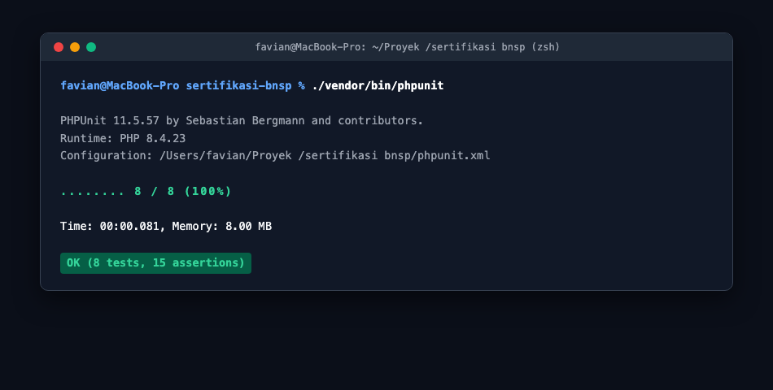
</p>

| ID Uji | Target Fungsi | Skenario Uji | Hasil Diharapkan | Status |
| :--- | :--- | :--- | :--- | :--- |
| **T-01** | `Pemesanan::hitungTotal()` | Kasus normal: 2 item menu (2x25rb + 3x5rb) | Total = Rp 65.000 | **LULUS** |
| **T-02** | `Pemesanan::hitungTotal()` | Edge case: tanpa item pesanan (kosong) | Total = 0.0 | **LULUS** |
| **T-03** | `Pemesanan::cekBentrok()` | Meja dan tanggal-jam sama persis | Terdeteksi bentrok (`true` / ditolak) | **LULUS** |
| **T-04** | `Pemesanan::cekBentrok()` | Meja sama, tanggal-jam berbeda | Tidak bentrok (`false` / diterima) | **LULUS** |
| **T-05** | `Pemesanan::validasiKapasitas()` | Tamu (5 orang) melebihi kapasitas meja (2 orang) | Ditolak (`false`) | **LULUS** |
| **T-06** | `format_rupiah()` | Format nominal angka 15000 | String `"Rp 15.000"` | **LULUS** |
| **T-07** | `validasi_input()` | Input string kosong / hanya spasi | Ditolak (`false`) | **LULUS** |
| **T-08** | `Pemesanan::tambahItem()` | Menu sama dipesan berulang (duplikat) | Kuantitas digabung/merge, tidak terduplikasi | **LULUS** |

### 5.2 Pemeriksaan Sintaksis Statis (PHP Lint)
Memastikan seluruh berkas bebas syntax error:
```bash
find src public -name "*.php" -exec php -l {} \;
```

<p align="center">
  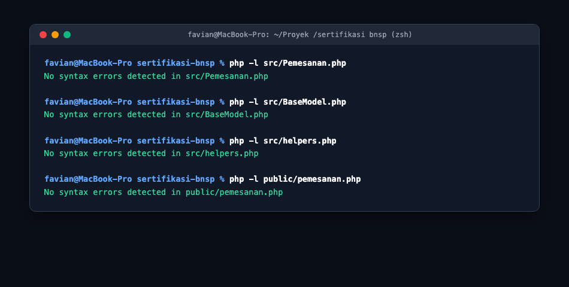
</p>

---

## 6. Pemetaan ke 9 Unit Kompetensi BNSP (KKNI Level 4)

| Kode Unit | Judul Unit Kompetensi | Bukti Implementasi di Proyek |
| :--- | :--- | :--- |
| **J.620100.009.01** | Menggunakan Spesifikasi Program | Kode mengacu persis pada PRD, ERD basis data, Use Case, Flowchart, dan Activity Diagram. |
| **J.620100.016.01** | Menulis Kode Sesuai Guidelines & Best Practices | Standar PSR-12, sanitasi `htmlspecialchars()`, penamaan camelCase/PascalCase, bebas syntax error. |
| **J.620100.017.02** | Mengimplementasikan Pemrograman Terstruktur | `src/helpers.php` memuat `declare(strict_types=1)`, seleksi `if/else`, perulangan `foreach`, `try/catch`. |
| **J.620100.018.02** | Mengimplementasikan Pemrograman Berorientasi Objek (OOP) | Abstract Class `BaseModel`, inheritance `Pelanggan`, `Meja`, `Menu`, enkapsulasi `Pemesanan`, polimorfisme `simpan()`. |
| **J.620100.019.02** | Menggunakan Library Pre-existing | Integrasi pustaka `dompdf/dompdf` (ekspor PDF), `phpunit/phpunit` (unit test), dan `Bootstrap 5` (UI responsif). |
| **J.620100.021.02** | Menerapkan Akses Basis Data | PDO prepared statements (anti-SQL Injection), foreign key constraints, indeks `idx_meja_waktu`. |
| **J.620100.023.02** | Membuat Dokumentasi Kode Program | DocBlock standar (`@param`, `@return`), komentar penjelasan alur validasi, dan `README.md` terstruktur. |
| **J.620100.025.02** | Melakukan Debugging | Penanganan error `try-catch`, pencatatan log ke `logs/app.log`, dan dokumentasi 4 kasus analisis bug. |
| **J.620100.033.02** | Melaksanakan Pengujian Unit Program | Eksekusi test suite PHPUnit 8 skenario pengujian dengan status 100% OK (15 assertions lolos). |

---

## 7. Evaluasi Library Pre-Existing (Unit J.620100.019.02)

| Nama Library | Fungsi dalam Aplikasi | Lisensi | Analisis Keuntungan vs Menulis Mandiri | Status & Kompatibilitas |
| :--- | :--- | :--- | :--- | :--- |
| **dompdf/dompdf** (v3.1.x) | Konversi dokumen HTML/CSS menjadi berkas PDF cetak | LGPL-2.1 | Menulis PDF renderer sendiri dari nol sangat kompleks dalam tata letak font dan margin. Dompdf mempermudah styling menggunakan CSS standar. | **Aktif**, stabil, kompatibel PHP 8.4. |
| **phpunit/phpunit** (v11.5.x) | Framework pengujian unit otomatis (*unit testing*) | BSD-3-Clause | Standar industri pengujian PHP. Menyediakan assertions lengkap dan reporting tanpa perlu membuat test runner manual. | **Aktif**, versi stabil resmi. |
| **Bootstrap 5** (v5.3.x) | Framework antarmuka pengguna (CSS & JS) | MIT | Mempercepat pembuatan tata letak responsif, sistem grid, modal interaktif, dan komponen UI modern yang konsisten. | **Aktif**, standar industri web. |

---

## 8. Catatan Kasus Debugging (Unit J.620100.025.02)

Berikut adalah 4 kasus bug nyata yang dianalisis dan diperbaiki selama pengembangan:

### Kasus Bug #1: Total Pemesanan Bernilai Null Saat Pesanan Belum Memiliki Menu
- **Temuan**: Saat reservasi baru dibuat tanpa item makanan/minuman, kolom `total` pada database bernilai `NULL`, memicu warning deprecated PHP 8.4 pada `format_rupiah()`.
- **Akar Masalah**: Fungsi agregat SQL `SUM(subtotal)` menghasilkan `NULL` jika belum ada baris di tabel `detail_pesanan`.
- **Perbaikan**: Menggunakan klausa SQL `COALESCE(SUM(subtotal), 0)` pada method `Pemesanan::updateTotalPemesanan()`.
- **Verifikasi**: Reservasi baru yang belum memiliki menu otomatis memiliki grand total `Rp 0` tanpa warning.

### Kasus Bug #2: Meja Terdeteksi Bentrok dengan Pemesanan yang Berstatus Dibatalkan
- **Temuan**: Pelanggan tidak bisa memesan meja pada jam tertentu karena ada reservasi lama yang sudah dibatalkan di jam yang sama.
- **Akar Masalah**: Query `cekBentrok()` semula tidak menyaring status reservasi.
- **Perbaikan**: Menambahkan klausa `AND status != 'Dibatalkan'` ke dalam kueri PDO prepared statement.
- **Verifikasi**: Meja yang reservasinya telah dibatalkan kini dapat langsung dipesan kembali.

### Kasus Bug #3: Karakter Khusus pada Input Pelanggan Menyebabkan Kerentanan XSS
- **Temuan**: Input nama pelanggan yang mengandung script HTML/JavaScript dieksekusi oleh peramban.
- **Akar Masalah**: Variabel langsung dicetak tanpa proses enkoding entitas HTML.
- **Perbaikan**: Mengimplementasikan `htmlspecialchars($trimmed, ENT_QUOTES, 'UTF-8')` pada fungsi `validasi_input()` dan setiap rendering view.
- **Verifikasi**: Input `<script>alert('test')</script>` aman ditampilkan sebagai teks biasa tanpa dieksekusi.

### Kasus Bug #4: Duplikasi Baris Item Menu yang Sama pada Pesanan
- **Temuan**: Menambahkan item menu yang sama berulang kali menghasilkan baris terpisah pada tabel rincian pesanan.
- **Akar Masalah**: Query selalu menjalankan `INSERT INTO detail_pesanan` tanpa pengecekan keberadaan menu yang sama.
- **Perbaikan**: Mengimplementasikan logika merge di `Pemesanan::tambahItem()` — jika menu sudah ada, sistem meng-UPDATE kuantitas dan subtotal; jika belum ada, sistem melakukan INSERT.
- **Verifikasi**: Menambahkan item "Nasi Goreng" ke pesanan yang sudah memuatnya otomatis menaikkan kuantitas tanpa duplikasi baris.

---

## 9. Contoh Demonstrasi OOP (Polymorphism & Overriding)

Contoh pembuktian konsep **Polymorphism** pada method `simpan()` yang dapat didemonstrasikan di hadapan Asesor:

```php
use App\BaseModel;
use App\Pelanggan;
use App\Meja;
use App\Menu;

// Array polimorfik yang menampung objek berbeda turunan BaseModel
/** @var BaseModel[] $daftarObjek */
$daftarObjek = [
    new Pelanggan("Joko Anwar", "081999888777"),
    new Meja(10, 6),
    new Menu("Kopi Tubruk", 10000.0)
];

// Eksekusi polimorfisme: memanggil method simpan() pada tipe objek berbeda
foreach ($daftarObjek as $obj) {
    // PHP secara dinamis mengeksekusi implementasi simpan() milik masing-masing child class
    $berhasil = $obj->simpan();
    echo get_class($obj) . " disimpan: " . ($berhasil ? "SUKSES" : "GAGAL") . "\n";
}
```

---

## 10. Dokumentasi Tangkapan Layar & Pengujian Sistem (Screenshots)

Berikut adalah dokumentasi visual dari implementasi antarmuka dan pembuktian logika sistem:

### 10.1 Modul Antarmuka Utama & Master Data (CRUD)

#### Gambar L.1: Dashboard Utama & Statistik Operasional
<p align="center">
  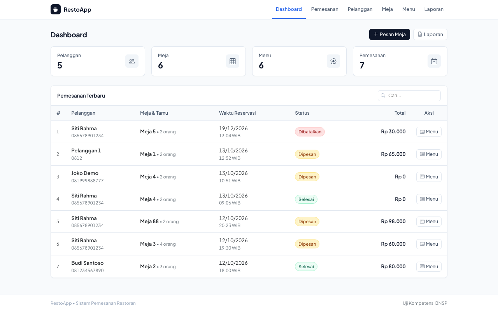
</p>

#### Gambar L.2: Antarmuka Pengelolaan Master Meja Restoran (CRUD)
<p align="center">
  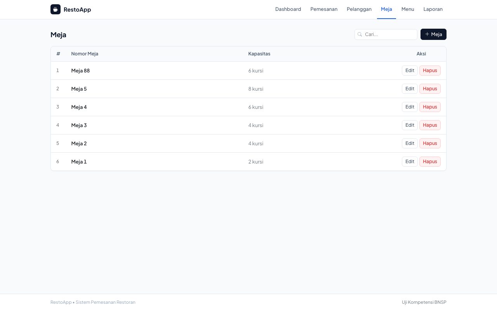
</p>

#### Gambar L.3: Antarmuka Pengelolaan Katalog Menu & Stok (CRUD)
<p align="center">
  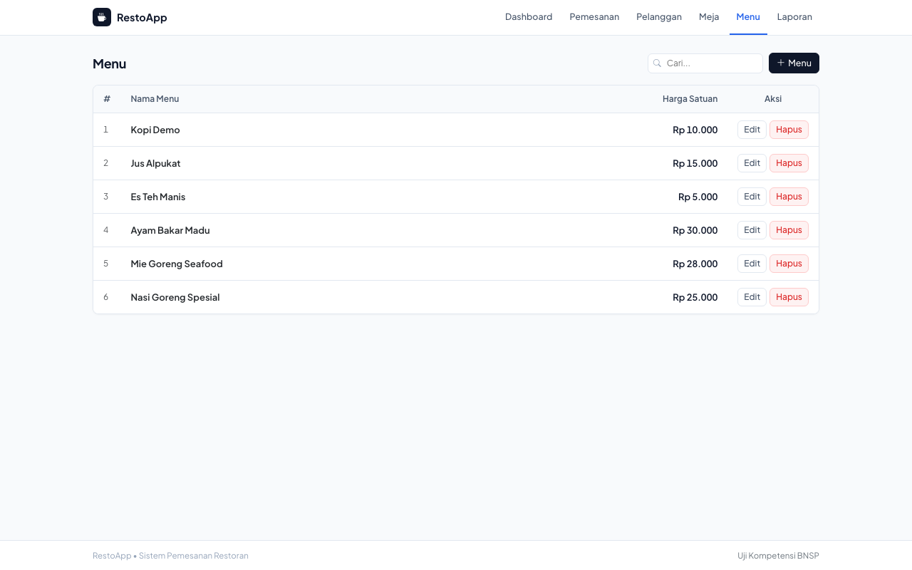
</p>

#### Gambar L.4: Antarmuka Master Pelanggan & Informasi Kontak (CRUD)
<p align="center">
  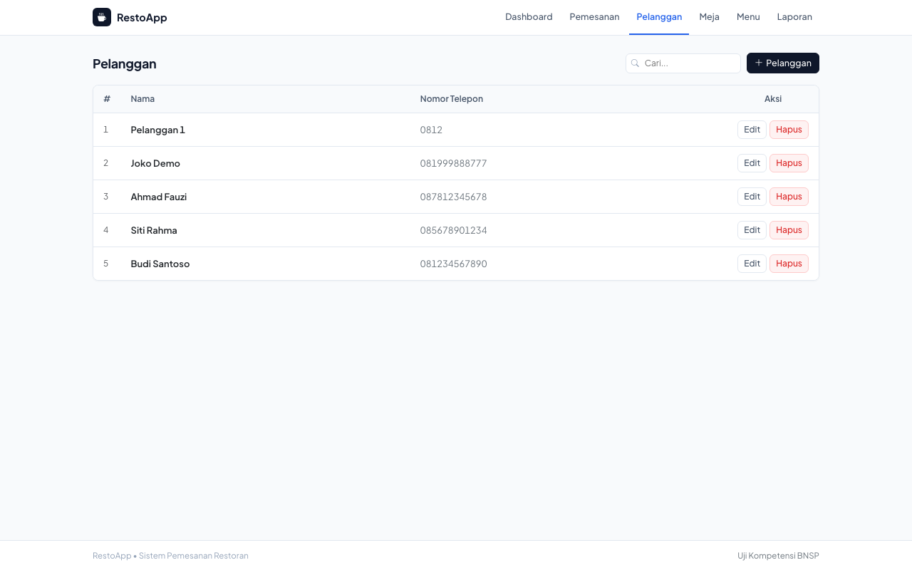
</p>

---

### 10.2 Transaksi Reservasi & Pembuktian Logika Bisnis (Activity Diagram)

#### Gambar L.5: Monitoring Transaksi Pemesanan & Reservasi Meja
<p align="center">
  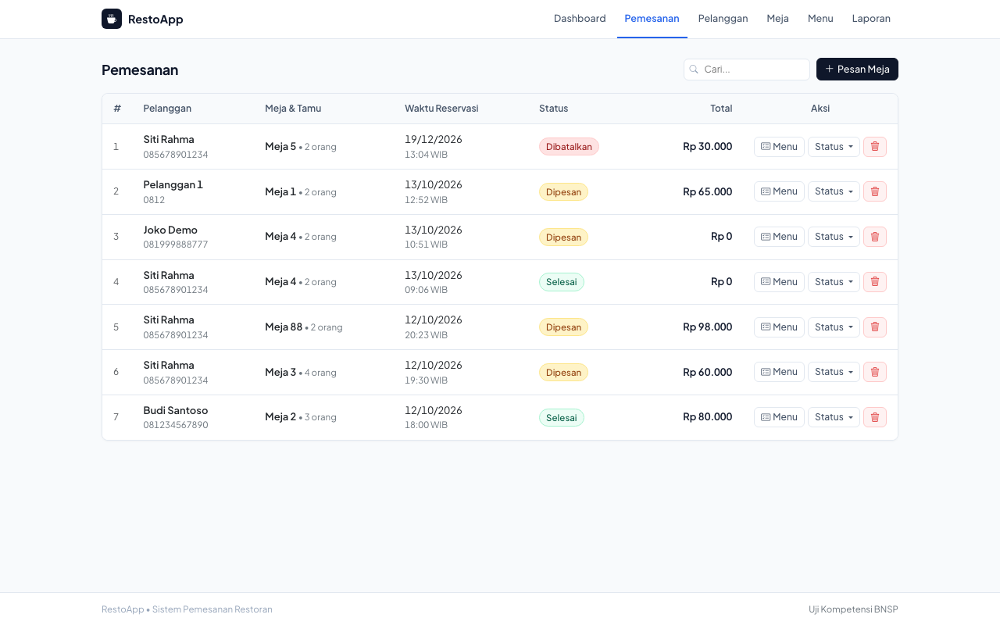
</p>

#### Gambar L.6: Modal Validasi Tahap 1 — Deteksi & Peringatan Kapasitas Meja Kurang (Tombol Disabled)
> **Bukti Activity Diagram Tahap 1 (Koreksi Kapasitas)**: Ketika tamu berjumlah 8 orang sedangkan Meja 1 hanya berkapasitas 2 orang, alert merah aktif dan tombol submit dinonaktifkan.
<p align="center">
  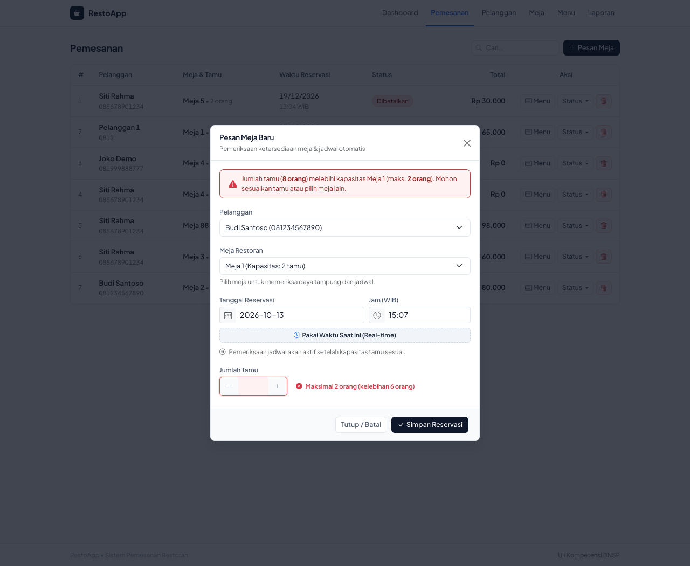
</p>

#### Gambar L.7: Modal Validasi Tahap 2 — Kapasitas Cukup & Jadwal Bebas Bentrok (Siap Simpan)
> **Bukti Activity Diagram Tahap 2 (Kapasitas & Jadwal Lolos)**: Meja 4 (kapasitas 6) untuk 4 tamu lolos verifikasi kapasitas dan pengecekan jadwal bebas bentrok. Notifikasi hijau aktif dan tombol submit siap ditekan.
<p align="center">
  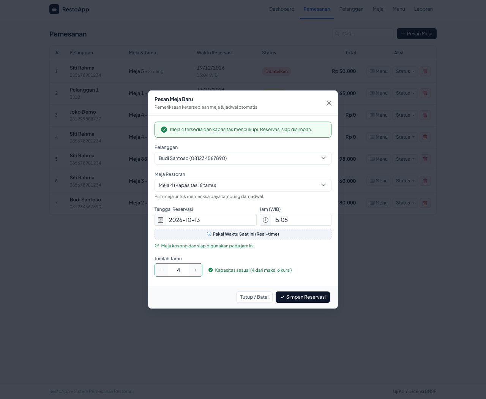
</p>

#### Gambar L.8: Rincian Pesanan Menu, Subtotal Otomatis, & Update Status
<p align="center">
  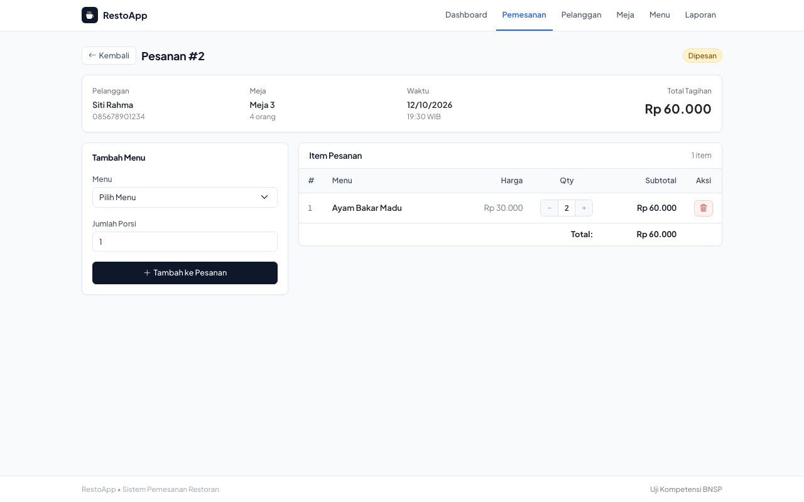
</p>

---

### 10.3 Laporan Rekapitulasi & Ekspor Dokumen Resmi PDF

#### Gambar L.9: Modul Laporan Transaksi & Filter Rentang Tanggal
<p align="center">
  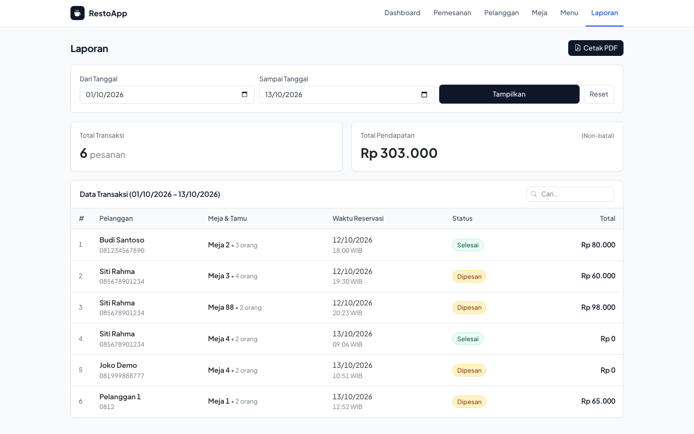
</p>

#### Gambar L.10: Dokumen Resmi Ekspor Laporan Transaksi Format PDF (Dompdf)
<p align="center">
  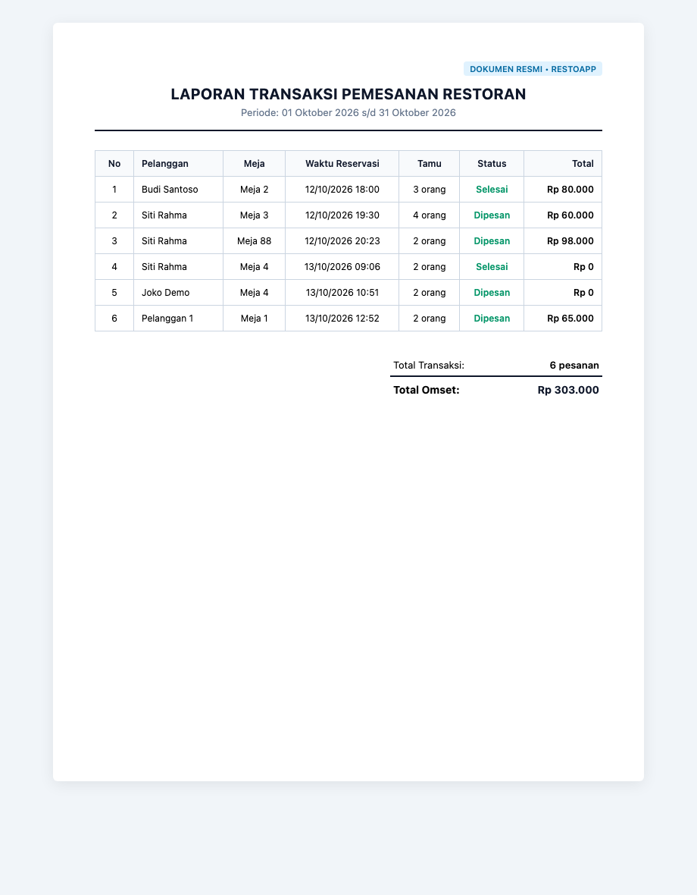
</p>

---

### 10.4 Pengujian Otomatis & Verifikasi Integritas Basis Data

#### Gambar L.11: Hasil Eksekusi Unit Testing Otomatis (PHPUnit 100% OK)
<p align="center">
  
</p>

#### Gambar L.12: Pemeriksaan Sintaksis Statis Kode PHP (PHP Lint Zero Error)
<p align="center">
  
</p>

#### Gambar L.13: Verifikasi Skema 5 Tabel Relasional & Indeks Komposit MySQL
<p align="center">
  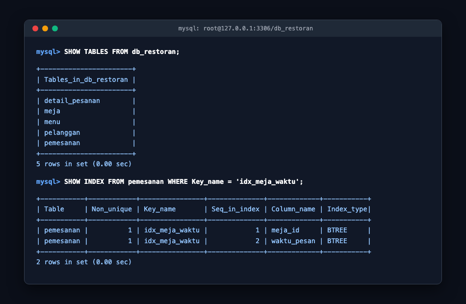
</p>
